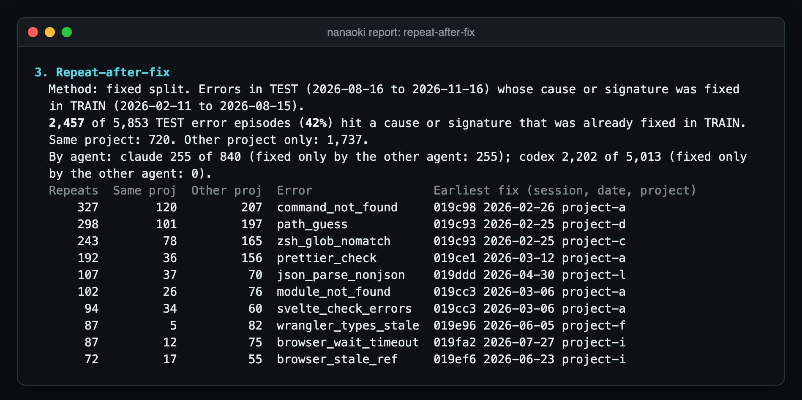
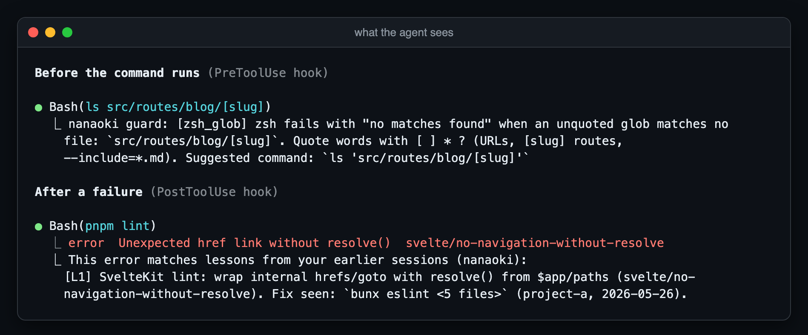
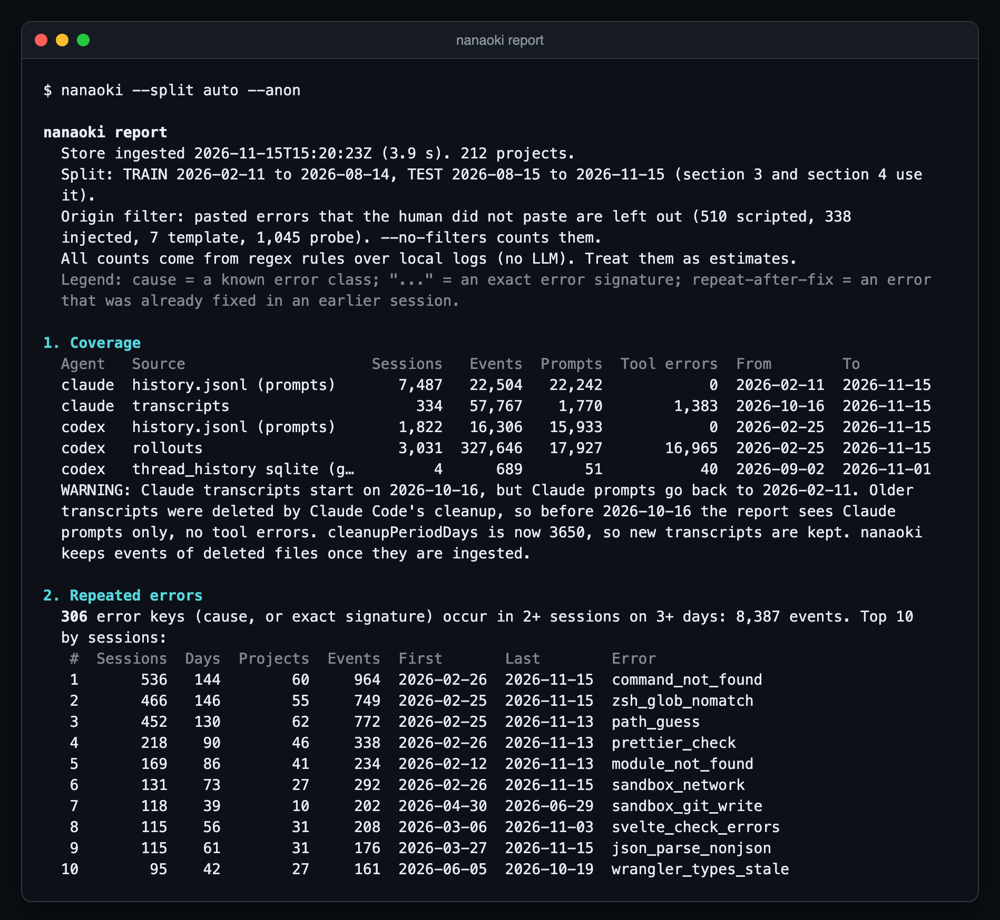

# nanaoki

Your coding agent fixed this error last month. In another project. Then it forgot.

I ran this on 9 months of my own Claude Code and Codex history (3,030 Codex sessions, 18K tool errors):

- **40%** of the errors from Sep to Nov were causes my agents had already fixed between Feb and Aug.
- **68%** of those repeats had the fix only in a **different project**.
- The top one, a zsh quoting error, showed up in **465 sessions across 54 projects**.
- I typed "don't make any changes yet" in **181 different sessions**.

`nanaoki` reads the history that is already on your machine, finds the mistakes your agents keep repeating, and shows the fix that worked last time, at the moment the same error comes back. Everything runs locally. No LLM, no network, no account.

## What it looks like

Your numbers, in one command:



Before a known-bad command runs, the agent gets a warning and the fixed command. After a failure, it gets the lesson from the session that already fixed it, even in another repo:



Search your past sessions. The answer ranks above the commands that only grep for the words:


The top of the report: coverage and the most repeated errors.



Screenshots use `--anon`, which hides project names, session ids and home paths. Use it when you share your report.

## Why not just CLAUDE.md?

I tested that first. On 108 real repeats from my history, replayed and scored by two AI judges (Claude and GPT, 93% agreement):

| | Repeats prevented | Context per trigger |
|---|---|---|
| No memory | 0% | 0 tokens |
| An AGENTS.md written from the earlier history | ~31% | ~1,700 tokens, every turn |
| Lessons shown at the moment of the error | 53-59% | ~36 tokens |

A rules file is good for stable decisions, so `nanaoki rules suggest` proposes those lines for your file. It loses on the long tail of one-off errors, and on fixes that live in another repo.

These numbers are one person's data and a replay, not live use. Run it on your history and see what yours are.

## Install

macOS or Linux:

```sh
curl -fsSL https://raw.githubusercontent.com/JustinyAhin/nanaoki/main/install.sh | sh
```

Homebrew:

```sh
brew install JustinyAhin/tap/nanaoki
```

With Go 1.26+:

```sh
go install github.com/JustinyAhin/nanaoki/cmd/nanaoki@latest
```

Windows: download the zip from the [releases page](https://github.com/JustinyAhin/nanaoki/releases).

## See your numbers

```sh
nanaoki                 # read your history, then print the report
nanaoki --split auto    # strict number: errors in the last third of your history
                        # whose cause was already fixed in the first two thirds
nanaoki --since 30d     # only the last 30 days (also 2w, 3m, 1y)
```

The report shows:

1. **Coverage**: which agents and sessions it found, and from when.
2. **Repeated errors**: the error causes that come back across sessions, days and projects.
3. **Repeat-after-fix**: errors whose cause an earlier session already fixed, and in which project.
4. **Time lost**: wall time from each repeated error to the next command that worked (an estimate).
5. **Restated rules**: instructions you keep typing in new sessions.
6. **Monthly trend**.
7. **Suggested fixes**: a rule, a hook, or an environment fact for each top item.

All counts come from regex rules over your logs. Treat them as estimates. `--format json` gives the evidence (file and line) for each number.

One tip: Claude Code deletes transcripts after 30 days by default. Set `"cleanupPeriodDays": 3650` in `~/.claude/settings.json` to keep them.

## Stop the repeats (plugin)

```sh
nanaoki lessons build   # build lessons from your history
nanaoki setup claude    # Claude Code plugin
nanaoki setup codex     # Codex hooks and skills (then trust them in /hooks)
```

After that, the plugin refreshes the lessons once a day in the background. See [PLUGIN.md](PLUGIN.md).

The plugin:

- warns before a few known-bad shell commands and suggests the fixed command (zsh quoting first);
- after a failed command, shows up to 3 lessons from your history that match the error, with where it was fixed;
- at the first prompt of a session, shows 1-2 rules that match the repo;
- stays quiet on probes (`cat x 2>/dev/null`, `test -f`, a grep with no match).

## Search your past sessions

```sh
nanaoki search "502 prerender" --since 3m
```

Full-text search over all your prompts, agent messages and tool output, with the session and time for each hit. Answers and questions rank above tool calls that only grep for the words. Hits from one session are grouped, and the session you run it from is left out (`--include-current` keeps it). `--paths` shows the source file and line. The `past-sessions` skill tells agents to use it when you ask "did we fix this before?".

## Rules you keep typing

```sh
nanaoki rules suggest
```

Prints lines for your `CLAUDE.md` / `AGENTS.md` based on what you restate across sessions. It never writes the file.

## Privacy

- Reads `~/.claude` and `~/.codex` (or `$CLAUDE_CONFIG_DIR`, `$CODEX_HOME`) read-only.
- Writes only to `~/.local/share/nanaoki/`. Delete that folder to remove everything. `nanaoki setup` is the exception: it installs the plugin and the Codex hooks when you run it.
- Makes no network calls. Sends nothing anywhere. (`nanaoki setup claude` asks the `claude` CLI to fetch the plugin from GitHub.)

## License

MIT
