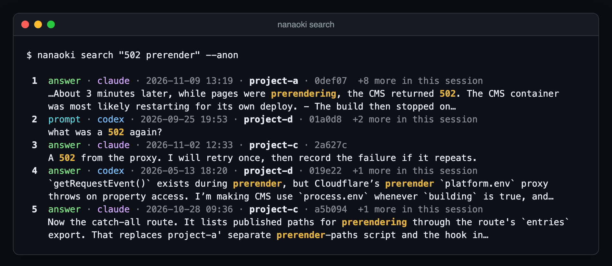

# nanaoki

Your coding agent keeps making the same mistake. It fixed it last month, in another repo.

`nanaoki` reads the Claude Code and Codex history already on your machine and finds the errors your agents keep hitting. When one comes back, the agent gets the fix that worked last time. Everything runs locally, with no LLM, no network calls and no account.

I ran it on 9 months of my own history (3,033 Codex sessions, about 19K tool errors):

- 43% of the errors from Sep to Nov were ones my agents had already hit and fixed between Feb and Aug.
- 69% of those repeats had the fix only in a different project.
- One zsh quoting error showed up in 471 sessions across 56 projects.
- I typed some version of "don't make any changes yet" in 183 sessions.

## What it looks like

Your number, in one command:


Before a command that's known to fail, the guard stops it and gives the agent the fixed command. After a failure, it gets the lesson from the session that fixed it, even if that was in another repo:


"Did we fix this before?" Search your old sessions. Real answers rank above tool calls that only grep for the words:



The top of the report, with coverage and the most repeated errors:


Screenshots use `--anon`, which hides project names, session ids and home paths. Use it if you share your report.

## Why not just CLAUDE.md?

I was sure a better CLAUDE.md would be enough, so I tested that first. I replayed 108 real cases from my history, and two AI judges (Claude and GPT, 93% agreement) scored whether each setup would have prevented what came next:

| | Repeats prevented | Context per trigger |
|---|---|---|
| Nothing | 0% | 0 tokens |
| An AGENTS.md written from my earlier history | ~31% | ~1,700 tokens, every turn |
| Lessons shown when the error happens | 53-59% | ~36 tokens |

The file does win on stable decisions like "commit only when I say so", so `nanaoki rules suggest` proposes those lines for your file. It loses on the long tail of one-off errors, and on fixes that live in another repo.

Read these numbers with care. This is my own data, from one laptop, and a replay scored by models. I haven't measured live use yet. Run it on your history and see what your number is.

## Install

If you are an agent installing this for someone, read [nanaoki.com/llms.txt](https://nanaoki.com/llms.txt) first.

macOS or Linux:

```sh
curl -fsSL https://raw.githubusercontent.com/JustinyAhin/nanaoki/main/install.sh | sh
```

Homebrew (third-party taps must be trusted first):

```sh
brew tap JustinyAhin/tap
brew trust JustinyAhin/tap
brew install nanaoki
```

With Go 1.26+:

```sh
go install github.com/JustinyAhin/nanaoki/cmd/nanaoki@latest
```

Windows: download the zip from the [releases page](https://github.com/JustinyAhin/nanaoki/releases).

## See your numbers

```sh
nanaoki                 # read your history, then print the report
nanaoki --split auto    # strict number: errors in the last third of your history
                        # whose cause was already fixed in the first two thirds
nanaoki --since 30d     # only the last 30 days (also 2w, 3m, 1y)
```

The report shows:

1. Coverage: which agents and sessions it found, and from when.
2. Repeated errors: the causes that come back across sessions, days and projects.
3. Repeat-after-fix: errors whose cause an earlier session already fixed, and in which project.
4. Time lost: wall time from each repeated error to the next command that worked. This one is an estimate.
5. Restated rules: instructions you keep typing in new sessions.
6. Monthly trend.
7. Suggested fixes: a rule, a hook or an environment fact for each top item.

There's no model in it. Every count comes from regex rules over your logs, so treat the counts as estimates. `--format json` gives the file and line behind each number.

If you use Claude Code, check one setting today. It deletes transcripts after 30 days by default. Set `"cleanupPeriodDays": 3650` in `~/.claude/settings.json` to keep them.

## Stop the repeats (plugin)

```sh
nanaoki lessons build   # build lessons from your history
nanaoki setup claude    # Claude Code plugin
nanaoki setup codex     # Codex hooks and skills (then trust them in /hooks)
```

After that, the plugin refreshes the lessons once a day in the background. See [PLUGIN.md](PLUGIN.md).

What the plugin does:

- Before a few shell commands that are known to fail, it blocks the command (or warns, when a block is not safe) and gives the fixed command. Unquoted zsh globs come first.
- After a failed command, it shows up to 3 lessons from your history that match the error, with where each one was fixed.
- At the first prompt of a session, it shows 1-2 rules that match the repo.
- It stays quiet on probes (`cat x 2>/dev/null`, `test -f`, a grep with no match).

## Search your past sessions

```sh
nanaoki search "502 prerender" --since 3m
```

Full-text search over all your prompts, agent messages and tool output, with the session and time for each hit. Answers and questions rank above tool calls that only grep for the words. Hits from one session are grouped, and the session you run it from is left out (`--include-current` keeps it). `--paths` shows the source file and line.

The `past-sessions` skill tells your agent to use it when you ask "did we fix this before?".

## Rules you keep typing

```sh
nanaoki rules suggest
```

Prints lines for your `CLAUDE.md` / `AGENTS.md` from what you restate across sessions. The suggestions can be noisy, so it only prints them. It never writes the file.

## Privacy

Session logs have your code in them, and your clients' code. I didn't want mine sent anywhere, so nanaoki sends nothing.

- It reads `~/.claude` and `~/.codex` (or `$CLAUDE_CONFIG_DIR`, `$CODEX_HOME`) and never changes them.
- It writes only to `~/.local/share/nanaoki/`. Delete that folder to remove everything. `nanaoki setup` is the exception: it installs the plugin and the Codex hooks when you run it.
- It makes no network calls. The one network step is `nanaoki setup claude`, which asks the `claude` CLI to fetch the plugin from GitHub.

## License

MIT
